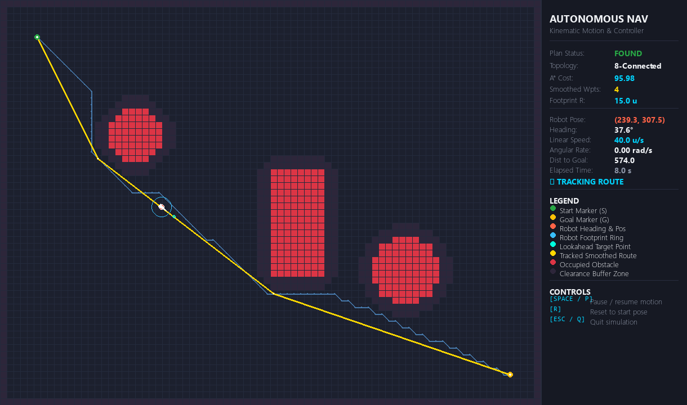
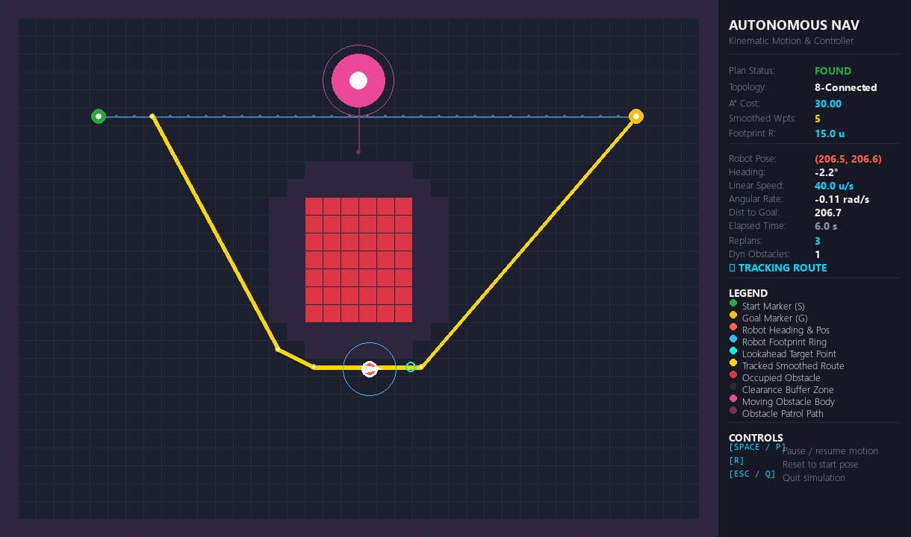
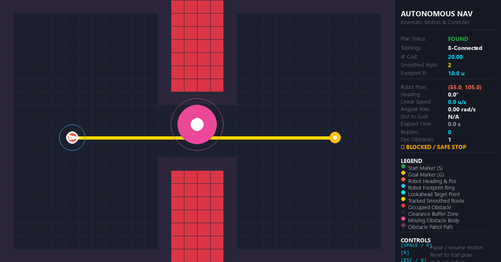

# AI-Based Autonomous Navigation System

| LIVE INTERACTIVE SIMULATOR (GITHUB PAGES) |
| :--- |
| **Test the full autonomous navigation pipeline, unicycle kinematics, and 2D planar LiDAR raymarching directly in your browser with zero installation:**<br>**[Launch Interactive Web Showcase](https://sahil2005-oss.github.io/AI-Based-Autonomous-Navigation-System/)** |

A deterministic 2D robotic navigation pipeline featuring footprint-aware A* path planning, conservative line-of-sight path smoothing, continuous kinematic unicycle motion tracking, dynamic obstacle detour replanning, and planar LiDAR range sensing.

---

## Executive Summary

Autonomous mobile robotics operating in constrained operational environments requires bridging the gap between discrete graph-search algorithms and continuous vehicle kinematics. In practical deployments, collisions and near-miss failures rarely originate from basic pathfinding logic. Instead, they stem from discrepancies between idealized point-mass robot assumptions, rasterization artifacts, aggressive corner-clipping between diagonal obstacles, perception latency, and moving obstacles.

This repository provides an end-to-end, deterministic autonomous navigation software stack implemented in Python. It features:
- Footprint-Safe Planning: Configurable circular robot footprint radius with strict boundary clearance and rasterized spatial inflation.
- Conservative Line-of-Sight Path Smoothing: Greedy raycasting post-processor delivering 84% to 95% waypoint reduction while guaranteeing zero corner-cutting collisions.
- Continuous Unicycle Kinematics: Pure Pursuit geometric path tracking controller commanding linear and angular velocities with lookahead steering and smooth deceleration.
- Online Dynamic Obstacle Detour Replanning: Real-time route conflict detection with isolated temporary planning grids for detour calculation without mutating the static world map.
- Guaranteed Fail-Safe Halting: Immediate zero-velocity stopping contract (ControllerStatus.BLOCKED) when corridors are impassable.
- Planar LiDAR Range Simulation: 2D time-of-flight laser rangefinder with configurable field of view, beam counts, raymarching, Gaussian range noise, and Euclidean spatial pointcloud clustering.
- Interactive Visualizers: Real-time desktop simulation window (Pygame) and live zero-dependency web dashboard deployed on GitHub Pages ([https://sahil2005-oss.github.io/AI-Based-Autonomous-Navigation-System/](https://sahil2005-oss.github.io/AI-Based-Autonomous-Navigation-System/)).

---

## System Architecture

```text
+-------------------------------------------------------------------------+
|                        Scenario Configuration                           |
|       (JSON: Arena Dimensions, Obstacles, Robot Radius, Velocities)     |
+------------------------------------+------------------------------------+
                                     |
                                     v
+-------------------------------------------------------------------------+
|                              World Model                                |
|  - Continuous-to-Discrete Coordinate Transformation                     |
|  - Solid Geometric Rasterization (Polygons, Circles, Rectangles)        |
|  - Robot Footprint Clearance Inflation and Boundary Margins             |
+------------------+------------------------------------+-----------------+
                   |                                    |
                   v                                    v
+------------------------------------+  +---------------------------------+
|          A* Path Planner           |  |       Planar LiDAR Sensor       |
|  - 4- and 8-Connected Topologies   |  |  - 2D Raymarching Engine        |
|  - Admissible Heuristic Functions  |  |  - Configurable FOV and Noise   |
|  - Diagonal Corner-Cut Prevention  |  |  - Pointcloud Spatial Clusters  |
+------------------+-----------------+  +---------------------------------+
                   | Raw Path
                   v
+-------------------------------------------------------------------------+
|                       Path Smoother (Post-Processor)                    |
|  - Conservative DDA / Bresenham Line-of-Sight Raycasting                |
|  - Continuous Swept-Footprint Segment Verification                      |
|  - 84.0% to 95.0% Redundant Waypoint Elimination                        |
+------------------------------------+------------------------------------+
                                     | Smoothed Path
                                     v
+-------------------------------------------------------------------------+
|                         Pure Pursuit Controller                         |
|  - Dynamic Lookahead Arc Steering Formulation                           |
|  - Heading Error Clamping and Angular Velocity Regulation               |
|  - Goal Proximity Linear Deceleration Profile                           |
+------------------+------------------------------------+-----------------+
                   |                                    |
                   v                                    v
+------------------------------------+  +---------------------------------+
|      Kinematic Motion Model        |  |   Dynamic Replanning Monitor    |
|  - State: (x, y, theta, v, omega)  |  |  - Online Route Conflict Check  |
|  - Velocity and Acceleration Limits|  |  - Isolated Temporary World Grid|
|  - Discrete Timestep Integration   |  |  - Fail-Safe Halting (BLOCKED)  |
+------------------------------------+  +---------------------------------+
```

---

## Visual Demonstrations

| LIVE INTERACTIVE SIMULATION WORKSPACE |
| :--- |
| **Every scenario illustrated below can be launched, observed, and tested in real time with continuous unicycle kinematics, 360-degree LiDAR raymarching, and dynamic obstacle replanning:**<br>**[Launch Live Interactive Simulator](https://sahil2005-oss.github.io/AI-Based-Autonomous-Navigation-System/)** |

### 1. Static Arena Navigation and Pure Pursuit Tracking
The robot navigates an 800 x 600 arena with mixed obstacles. The raw A* trajectory (80 waypoints) is post-processed into a 4-waypoint smoothed trajectory (95% reduction). The robot executes continuous kinematic tracking with active footprint clearance.

**Interactive Online Simulation:** [Launch "Default Navigation Arena" Live](https://sahil2005-oss.github.io/AI-Based-Autonomous-Navigation-System/)



### 2. Dynamic Obstacle Conflict and Online Detour Replanning
A moving obstacle patrols across the planned route. The controller detects the spatial conflict, isolates a temporary planning layer, computes a collision-free bypass detour, and reaches the goal safely.

**Interactive Online Simulation:** [Launch "Dynamic Obstacle Detour" Live](https://sahil2005-oss.github.io/AI-Based-Autonomous-Navigation-System/)



### 3. Blocked Corridor Fail-Safe Halting
When obstacles completely obstruct all possible corridors, the replanning system determines that no traversable route exists. The robot halts safely at a distance with zero velocity, transitioning to status BLOCKED with zero collisions.

**Interactive Online Simulation:** [Launch "Blocked Corridor Safe Stop" Live](https://sahil2005-oss.github.io/AI-Based-Autonomous-Navigation-System/)



---

## Technical Specifications and Performance

| Metric | Measured Value | Verification Standard |
| :--- | :--- | :--- |
| Discrete Grid Resolution | 10.0 world units | Discretized 2D grid matrix |
| Robot Footprint Model | Circular (R = 15.0 u) | Swept-footprint segment verification |
| Waypoint Reduction | 84.0% to 95.0% | Conservative line-of-sight raycasting |
| Continuous Path Length Reduction | Up to 6.33% | Euclidean shortcutting |
| Planning Execution Time | 0.6 ms to 168 ms | Python runtime on benchmark arena |
| Dynamic Replanning Overhead | < 1.5 ms per replan | Sub-millisecond temporary world query |
| LiDAR Scanning Range | 2.0 u to 200.0 u | Planar raymarching with noise model |
| Unit and Integration Tests | 174 passed / 0 failed | Automated pytest regression suite |

---

## Quick Start and Installation

### Prerequisites
- Python 3.11 or Python 3.12
- Supported Operating Systems: Windows 10/11, Ubuntu 20.04+, macOS 12+

### Installation Steps

1. Clone the repository:
   ```bash
   git clone https://github.com/Sahil2005-OSS/AI-Based-Autonomous-Navigation-System.git
   cd AI-Based-Autonomous-Navigation-System
   ```

2. Create and activate a virtual environment:
   - Windows PowerShell:
     ```powershell
     python -m venv .venv
     .\.venv\Scripts\Activate.ps1
     ```
   - Linux / macOS:
     ```bash
     python3 -m venv .venv
     source .venv/bin/activate
     ```

3. Install required dependencies:
   ```bash
   pip install --upgrade pip
   pip install -r requirements.txt
   ```

4. Verify installation via test suite:
   - Windows PowerShell:
     ```powershell
     $env:PYTHONPATH="src"; .\.venv\Scripts\pytest.exe -q
     ```
   - Linux / macOS:
     ```bash
     PYTHONPATH=src pytest -q
     ```
   Expected result: 174 passed in approximately 5 seconds.

---

## How to Run the System

### Option A: Interactive Web Dashboard (Zero Installation Required)

The project includes an interactive web dashboard with an HTML5 2D canvas simulation engine, real-time unicycle trajectory tracking, scenario switching, and live telemetry.

- **Live Online Demo (GitHub Pages):**
  Access the interactive simulation directly in your browser:
  [https://sahil2005-oss.github.io/AI-Based-Autonomous-Navigation-System/](https://sahil2005-oss.github.io/AI-Based-Autonomous-Navigation-System/)

- **Run Locally via Python HTTP Server:**
  1. Start the local server:
     - Windows PowerShell:
       ```powershell
       .\.venv\Scripts\python.exe -m http.server 8080 --directory docs
       ```
     - Linux / macOS:
       ```bash
       python3 -m http.server 8080 --directory docs
       ```
  2. Open your web browser and navigate to:
     ```text
     http://localhost:8080
     ```

3. Interactive Dashboard Controls:
   - Scenario Selector: Switch between Default Arena, Dynamic Detour, Blocked Corridor, Wall Detour, and Open World.
   - Play / Pause: Toggle real-time kinematic simulation.
   - Step: Advance simulation forward by one time step (0.05 s).
   - Reset: Restore robot and dynamic obstacles to initial configuration.
   - Speed Selector: Adjust playback velocity between 1x, 2x, and 4x.

---

### Option B: Interactive Desktop Pygame Simulation

Requires a local display environment.

1. Continuous Motion Mode (Pure Pursuit tracking with dynamic obstacles):
   ```powershell
   $env:PYTHONPATH="src"; .\.venv\Scripts\python.exe src/autonomous_nav/main.py --visualize --motion
   ```

2. Dynamic Obstacle Detour Demonstration:
   ```powershell
   $env:PYTHONPATH="src"; .\.venv\Scripts\python.exe src/autonomous_nav/main.py --config config/scenarios/dynamic_obstacle.json --visualize --motion
   ```

3. Blocked Corridor Safe Halting Demonstration:
   ```powershell
   $env:PYTHONPATH="src"; .\.venv\Scripts\python.exe src/autonomous_nav/main.py --config config/scenarios/dynamic_obstacle_blocked.json --visualize --motion
   ```

4. Interactive Desktop Controls:
   - SPACE or P: Pause or resume simulation.
   - R: Reset robot pose and obstacles to initial state.
   - ESC or Q: Close visualizer window cleanly.

---

### Option C: Headless Command-Line Interface (CLI)

1. Baseline Path Planning and Smoothing:
   ```powershell
   $env:PYTHONPATH="src"; .\.venv\Scripts\python.exe src/autonomous_nav/main.py
   ```

2. Continuous Kinematic Simulation:
   ```powershell
   $env:PYTHONPATH="src"; .\.venv\Scripts\python.exe src/autonomous_nav/main.py --motion
   ```

3. Run Benchmark Suite:
   ```powershell
   $env:PYTHONPATH="src"; .\.venv\Scripts\python.exe src/autonomous_nav/main.py --evaluate
   ```

---

## Benchmark Evaluation Results

The evaluation benchmark evaluates six deterministic navigation scenarios headlessly and writes structured metrics to `results/evaluation_report.json`:

```text
+--------------------------+------+-------+-----------+----------------+-------------+--------------+----------+---------+--------------+--------+
| Scenario Name            | Plan | Nodes | Plan Time | Waypoints      | Planned Len | Traveled Len | Sim Time | Replans | Outcome      | Safety |
+--------------------------+------+-------+-----------+----------------+-------------+--------------+----------+---------+--------------+--------+
| default_navigation_arena | PASS | 1846  | 134.27 ms | 80->4 (-95.0%) | 899.3 u     | 893.5 u      | 30.10 s  | N/A     | REACHED_GOAL | SAFE   |
| open_world_straight      | PASS | 15    | 1.14 ms   | 15->2 (-86.7%) | 198.0 u     | 193.0 u      | 12.65 s  | N/A     | REACHED_GOAL | SAFE   |
| obstacle_detour          | PASS | 158   | 13.63 ms  | 25->4 (-84.0%) | 263.6 u     | 257.9 u      | 14.30 s  | N/A     | REACHED_GOAL | SAFE   |
| blocked_unreachable      | FAIL | 126   | 10.17 ms  | N/A            | N/A         | N/A          | N/A      | N/A     | NOT_RUN      | N/A    |
| insufficient_clearance   | FAIL | 110   | 7.29 ms   | N/A            | N/A         | N/A          | N/A      | N/A     | NOT_RUN      | N/A    |
| dynamic_obstacle_detour  | PASS | 31    | 1.08 ms   | 31->2 (-93.5%) | 300.0 u     | 439.8 u      | 19.05 s  | 3/3     | REACHED_GOAL | SAFE   |
+--------------------------+------+-------+-----------+----------------+-------------+--------------+----------+---------+--------------+--------+
```

Summary: 6 scenarios evaluated, 4 navigation successes, 2 expected planning failures, 0 unexpected runtime errors.

---

## Automated Test Coverage

The test suite consists of 174 automated unit and integration tests distributed across 12 modules:

```text
tests/
├── test_basic_skeleton.py         # Entry point initialization (2 tests)
├── test_config_loader.py          # JSON schema validation and bounds (5 tests)
├── test_world.py                  # Grid transforms, rasterization, inflation (21 tests)
├── test_planner.py                # A* admissibility, heuristics, topologies (19 tests)
├── test_path_smoother.py          # Line-of-sight raycasting and corner safety (15 tests)
├── test_motion_model.py           # Unicycle kinematics and limits (9 tests)
├── test_controller.py             # Pure Pursuit tracking and stopping (14 tests)
├── test_footprint_clearance.py    # Swept-footprint geometric collision checks (21 tests)
├── test_evaluation.py             # Evaluation suite integrity and schema (15 tests)
├── test_dynamic_obstacles.py      # Moving obstacles, replanning, and safe stop (23 tests)
├── test_lidar.py                  # Planar LiDAR raymarching, noise, and clustering (11 tests)
└── test_visualizer.py             # Headless visualizer event processing (19 tests)
```

Run test suite with verbose output:
```powershell
$env:PYTHONPATH="src"; .\.venv\Scripts\pytest.exe -v
```

---

## Repository Directory Structure

```text
AI BASED AUTONOMOUS NAVIGATED SYSTEM/
├── .gitignore                     # Git ignore rules for venv, cache, OS files
├── requirements.txt               # Locked project dependencies
├── README.md                      # Comprehensive project documentation
├── assets/                        # Visual evidence demonstration screenshots
│   ├── demo_static_arena.png
│   ├── demo_dynamic_detour.png
│   └── demo_blocked_safestop.png
├── config/                        # Scenario definition JSON files
│   ├── default_scenario.json
│   └── scenarios/
│       ├── open_world.json
│       ├── obstacle_detour.json
│       ├── blocked_unreachable.json
│       ├── insufficient_clearance.json
│       ├── dynamic_obstacle.json
│       └── dynamic_obstacle_blocked.json
├── documentation/                 # Formal engineering specification documents
│   ├── README.md
│   ├── architecture.md
│   ├── data_flow.md
│   ├── modules.md
│   ├── datasets.md
│   ├── model_safety_and_risks.md
│   └── execution_and_validation_log.md
├── results/                       # Automated evaluation benchmark exports
│   └── evaluation_report.json
├── scripts/                       # Utility scripts
│   └── capture_assets.py          # Headless automated screenshot generator
├── src/                           # Core autonomous navigation package
│   └── autonomous_nav/
│       ├── __init__.py
│       ├── config_loader.py       # Configuration schema parsing
│       ├── world.py               # Occupancy grid and swept-footprint checks
│       ├── planner.py             # Footprint-aware A* path planning
│       ├── path_smoother.py       # Conservative line-of-sight smoothing
│       ├── motion_model.py        # Continuous kinematic unicycle model
│       ├── controller.py          # Pure Pursuit tracking and replanning
│       ├── dynamic_obstacle.py    # Moving obstacle patrol modeling
│       ├── lidar.py               # Planar 2D LiDAR raymarching simulator
│       ├── visualizer.py          # 2D Pygame visual simulation
│       ├── evaluation.py          # Headless benchmark evaluation runner
│       └── main.py                # Command-line entry point
├── tests/                         # Full automated unit and integration suite
└── web/                           # Standalone browser showcase dashboard
    ├── index.html
    ├── style.css
    └── app.js
```

---

## Operational Limitations and Safety Boundary Policies

1. Kinematic Unicycle Model: The robot is simulated under non-holonomic unicycle kinematics. Higher-order dynamic effects such as wheel slip, tire friction limits, terrain inclination, and motor torque saturation are outside the operational scope of this model.
2. Planar Discrete Simulation: The environment is modeled as a 2D planar workspace. Elevation changes, 3D overhanging obstacles, and rough terrain traversability are not modeled.
3. Synchronous Sensor Simulation: The LiDAR module assumes instantaneous raycasting within the simulation time step. Real-world rolling-shutter sensor distortion and communication latency are not modeled.
4. Absence of Collisions in Simulation: Zero collisions across tested deterministic benchmarks confirms algorithmic correctness under stated assumptions. It does not constitute an unconstrained universal safety guarantee for physical vehicle deployment without redundant hardware interlocks.

---

## License

This project is licensed under the MIT License. See the LICENSE file for details.
